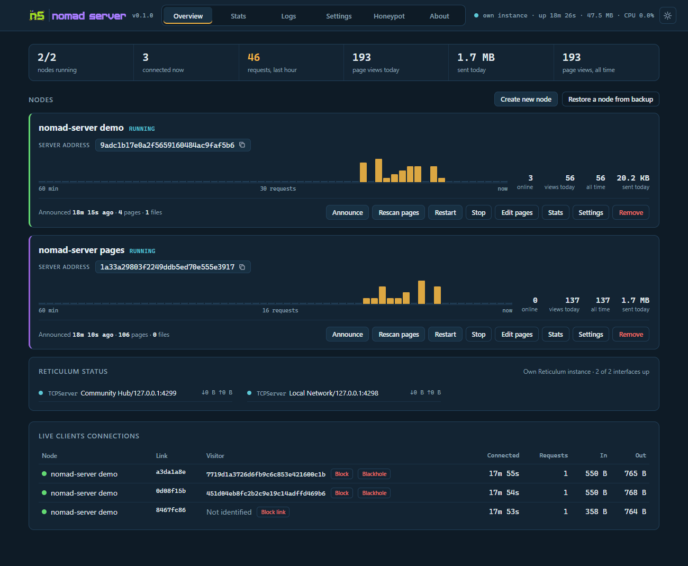
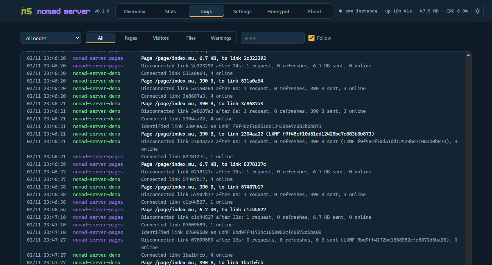
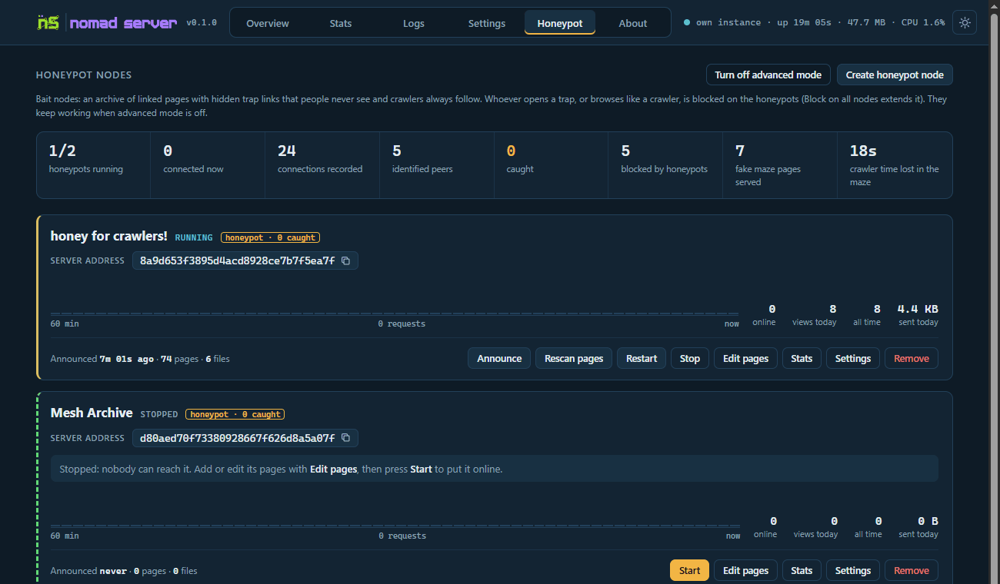

# nomad-server

<picture>
  <source media="(prefers-color-scheme: dark)" srcset="nserver/web/splash-dark.svg">
  
</picture>

Tanti nodi [NomadNet](https://github.com/markqvist/NomadNet) in un solo processo, con una web UI per seguirli e gestirli.

[](LICENSE) · [English](README.md)

**Guida di installazione (PDF):** [Italiano](docs/nomad-server_Guida_Installazione_IT.pdf) · [English](docs/nomad-server_Install_Guide_EN.pdf) - Windows, Linux, Raspberry Pi, venv e Docker, il primo nodo, gli aggiornamenti e gli errori comuni.



## Cosa fa

- **Tanti nodi, un processo**: ogni nodo ha la sua cartella, identità, pagine, file e contatori
- **Serve come NomadNet**: pagine `.mu`, pagine eseguibili, liste `.allowed`, download `/file/`, immagini nelle pagine
- **Web UI**: panoramica, statistiche per ora e per giorno, log in diretta, impostazioni, editor delle pagine, tema chiaro e scuro
- **Contatori**: ogni richiesta e ogni byte, segnaposto `{{visits}}` nelle pagine, probabili crawler segnalati
- **Visitatori**: chi è collegato, chi si è identificato, blocco di un peer o di un singolo link, blackhole di un'identità in Reticulum
- **Plugin**: pagine dinamiche in Python dentro il server (guestbook, moduli, dati live), anche su Windows
- **Backup**: uno zip per nodo, export e import dell'identità, cestino dei nodi rimossi
- **Nodi honeypot** (avanzato): pagine esca e trappole nascoste che catturano i crawler
- Gira su Windows, Linux, macOS, Raspberry Pi e Docker; serve solo `rns`

## Avvio rapido

```
git clone https://github.com/fr33n0w/nomad-server
cd nomad-server
pip install rns
python nomad_server.py
```

Apri http://127.0.0.1:8484, premi **Create new node**, metti le pagine in `nodes/<nodo>/pages/` (`index.mu` è la home) e premi **Start**. I nodi nuovi partono fermi, così niente va in rete prima di essere pronto.

Se `rnsd` è acceso, i nodi usano quello; altrimenti nomad-server avvia una sua istanza Reticulum con la config di `~/.reticulum`.

## Modi di avvio

| Come | Comando | Note |
|---|---|---|
| Terminale | `python nomad_server.py` | log a schermo, Ctrl+C lo ferma |
| Finestra app | `python nomad_server.py --app` | la UI in una finestra sua (pywebview se installato, altrimenti Edge o Chrome); chiudendola si ferma il server che ha avviato |
| Windows | `start.bat`, `start_hidden.vbs` | il secondo gira senza nessuna finestra |
| Windows senza Python | `NomadServer-CLI-v0.1.4-win.exe`, `NomadServer-APP-v0.1.4-win.exe` | da [Releases](https://github.com/fr33n0w/nomad-server/releases), vedi [Programmi senza Python](#programmi-senza-python) |
| Icone | Settings > Shortcuts | desktop e menu app, Windows e desktop Linux |
| Debian, Ubuntu, Raspberry Pi | `bash install.sh` | service systemd all'avvio, vedi [Installer](#installer-debian-ubuntu-raspberry-pi) |
| pipx | `pipx install git+https://github.com/fr33n0w/nomad-server` | poi `nomad-server`; dati in `~/.nomad-server` |
| Docker | `mkdir nomad-data && docker compose up -d` | vedi [Docker](#docker) |

Su una cartella gira un solo server: le stesse identità non vanno mai in rete due volte. Rilanciato con `--app`, apre solo la finestra.

### Programmi senza Python

Senza Python, per ora per Windows: estrai lo zip e doppio clic.

| Programma | Cos'è |
|---|---|
| `NomadServer-CLI-v0.1.4-win.exe` | il server col suo terminale, come `python nomad_server.py` |
| `NomadServer-APP-v0.1.4-win.exe` | senza terminale, la UI in una finestra sua; chiudendola il server si ferma |

**I dati stanno accanto al programma**: `server.cfg`, `nodes\` e `data\` nella cartella del programma. Una copia estratta da un'altra parte è un server nuovo e vuoto, con indirizzi dei nodi nuovi. Per usare sempre lo stesso server, dagli la sua cartella con `--base`, anche nei collegamenti sul desktop (Proprietà > Destinazione):

```
NomadServer-APP-v0.1.4-win.exe --base D:\nomad-data
```

`--base` accetta anche la cartella di un'installazione esistente, con i suoi nodi e impostazioni: prima ferma quel server. Le icone create da Settings > Shortcuts hanno già la loro cartella.

**Aggiornare**: la versione è nel nome del file, quindi uno zip nuovo estratto altrove è un server nuovo e vuoto. Estrailo sopra la cartella vecchia (`server.cfg`, `nodes\` e `data\` restano), oppure tieni i dati in una cartella a parte con `--base`. Poi premi di nuovo Settings > Shortcuts: le icone puntano ancora all'exe vecchio.

### Installer (Debian, Ubuntu, Raspberry Pi)

```
sudo apt install git python3-pip
git clone https://github.com/fr33n0w/nomad-server
cd nomad-server
bash install.sh
```

Va lanciato come utente normale (non root): usa `sudo` solo per installare il service. Fa questo:

1. installa `rns` se manca: nel venv se ce n'è uno (vedi [venv](#in-un-ambiente-virtuale-venv)), altrimenti chiede prima di installarlo per il tuo utente (`pip --user`)
2. se la porta della web UI (8484) è già occupata, ne chiede un'altra
3. chiede se aprire la web UI alla rete locale (`0.0.0.0`); se sì, chiede una password (vuota = nessuna)
4. chiede il nome del primo nodo (solo se non ci sono ancora nodi)
5. chiede se installare il service systemd `nomad-server`: parte all'avvio, col tuo utente, da questa cartella, dopo `rnsd` se esiste `rnsd.service`. Se `nomad-server` è già usato da un'altra cartella, chiede un nome per questa (es. `nomad-server-2`), così più server girano affiancati.

Rilanciarlo non fa danni: nodi, impostazioni e nome del service restano, e il service viene riavviato. Poi (col nome del tuo service):

| Cosa | Comando |
|---|---|
| stato | `python3 nomad_server.py --status` (in un venv: `venv/bin/python3 nomad_server.py --status`) |
| log | `journalctl -u nomad-server -f` |
| stop, avvio, riavvio | `sudo systemctl stop nomad-server` (`start`, `restart`) |
| aggiornare | `git pull`, poi `sudo systemctl restart nomad-server` |
| togliere il service | `sudo systemctl disable --now nomad-server && sudo rm /etc/systemd/system/nomad-server.service && sudo systemctl daemon-reload` |

Sotto systemd `--stop` viene rifiutato (systemd lo farebbe ripartire): usa `systemctl`. Il riavvio dalla web UI funziona.

**rnsd con un altro utente.** Le pagine vengono servite lo stesso, ma `rnsd` rifiuta le richieste di stato degli altri utenti: niente stato di Reticulum nella web UI e niente nomi dei visitatori (lo dice il log). Dai a nomad-server la stessa chiave RPC di `rnsd`. Con l'utente di `rnsd`:

```
python3 -c "import RNS, os; print(RNS.Identity.full_hash(RNS.Identity.from_file(os.path.expanduser('~/.reticulum/storage/transport_identity')).get_private_key()).hex())"
```

poi, in `~/.reticulum/config` dell'utente di nomad-server, sotto `[reticulum]`, aggiungi `rpc_key = <quella chiave>` e riavvia nomad-server. La chiave dà il controllo di `rnsd`: tienila privata.

### In un ambiente virtuale (venv)

Un venv tiene `rns` e le sue librerie dentro la cartella di nomad-server, separati dal Python di sistema. Su Debian, Ubuntu e Raspberry Pi OS prima: `sudo apt install git python3-venv`.

**Con l'installer** (Debian, Ubuntu, Raspberry Pi), per un server che parte all'avvio:

```
git clone https://github.com/fr33n0w/nomad-server
cd nomad-server
python3 -m venv venv
bash install.sh
```

L'installer trova da solo `venv` (o `.venv`) nella cartella, anche se non è attivato: ci installa `rns` e il service gira col python del venv. Rilanciandolo più avanti continua a usare il venv. Funziona anche un venv tenuto altrove (es. `~/venvs/nomad`): attivalo prima di `bash install.sh`. Fuori da un venv non installa niente senza chiedere: se nessun venv è in uso, rispondi `n` e l'installer si ferma senza aver cambiato nulla. Poi è tutto come in [Installer](#installer-debian-ubuntu-raspberry-pi), col python del venv per i comandi:

| Cosa | Comando |
|---|---|
| stato | `venv/bin/python nomad_server.py --status` |
| log | `journalctl -u nomad-server -f` |
| aggiornare | `git pull`, `venv/bin/pip install -U rns`, poi `sudo systemctl restart nomad-server` |

**A mano** (Linux, macOS, Raspberry Pi):

```
git clone https://github.com/fr33n0w/nomad-server
cd nomad-server
python3 -m venv venv
venv/bin/pip install rns
venv/bin/python nomad_server.py
```

Windows:

```
git clone https://github.com/fr33n0w/nomad-server
cd nomad-server
python -m venv venv
venv\Scripts\pip install rns
venv\Scripts\python nomad_server.py
```

Poi come in [Avvio rapido](#avvio-rapido): apri http://127.0.0.1:8484, premi **Create new node**, poi **Start**. Ctrl+C ferma il server.

Usa il python del venv per ogni comando: `venv/bin/python nomad_server.py --status` (anche `--stop`, `--new-node NOME`, `--app`, ...), oppure lancia una volta `source venv/bin/activate` (Windows `venv\Scripts\activate`) nel terminale e poi `python` normale. Per aggiornare: `git pull` e `venv/bin/pip install -U rns`. Le icone create da Settings > Shortcuts usano il venv da sole.

**Come comando**: `venv/bin/pip install git+https://github.com/fr33n0w/nomad-server`, poi `venv/bin/nomad-server` (dati in `~/.nomad-server`).

**Dove gira Reticulum.** Il venv ha sempre bisogno del suo `rns`: è la libreria di cui è fatto nomad-server. Chi fa girare la rete Reticulum lo scegli tu:

- *rnsd già installato per il tuo utente, nomad-server nel venv*: non serve altro. nomad-server si collega al `rnsd` acceso e l'installer lo fa partire dopo `rnsd.service`; quando `rnsd` si riavvia, nomad-server si ricollega da solo. Fai girare nomad-server con lo stesso utente di `rnsd` (altrimenti vedi *rnsd con un altro utente* più sopra) e tieni le due copie di `rns` alla stessa versione (`pip install -U rns` su entrambe).
- *Tutto nel venv, senza rnsd*: nomad-server fa girare Reticulum da solo, con le interfacce di `~/.reticulum/config`. Fuori dal venv non viene installato niente. Mentre gira, altri programmi (NomadNet, rBrowser) possono usarlo come istanza condivisa; restano scollegati mentre nomad-server si riavvia.
- *Tutto nel venv, rnsd dal venv*: `rns` nel venv contiene anche `venv/bin/rnsd`. Fanne un service, poi lancia l'installer (trova `rnsd.service` e parte dopo). Dalla cartella di nomad-server:

```
python3 -m venv venv
venv/bin/pip install rns
sudo tee /etc/systemd/system/rnsd.service >/dev/null <<EOF
[Unit]
Description=Reticulum rnsd (venv)
After=network-online.target
Wants=network-online.target

[Service]
User=$USER
ExecStart=$PWD/venv/bin/rnsd --service
Restart=always
RestartSec=10

[Install]
WantedBy=multi-user.target
EOF
sudo systemctl daemon-reload
sudo systemctl enable --now rnsd
bash install.sh
```

Se la porta della web UI è già occupata (per esempio da un altro nomad-server), il server si ferma con un messaggio: cambia `port` nella sezione `[webui]` di `server.cfg` e rilancialo.

## Riga di comando

`python nomad_server.py [opzioni]`, oppure `nomad-server [opzioni]` se installato con pip o pipx.

**Avvio del server**

| Opzione | |
|---|---|
| *(nessuna)* | avvia, log nel terminale |
| `--app` | apre anche la web UI in una finestra app (pywebview se installato, altrimenti Edge o Chrome); chiudendola si ferma il server che ha avviato. Se il server gira già, apre solo la finestra |
| `--service` | silenzioso: nel terminale o nel journal solo avvisi ed errori, log completo in `logs/server.log` |
| `--no-webui` | senza interfaccia web; i comandi da console qui sotto funzionano lo stesso |
| `--verbose` | log di debug di Reticulum |
| `--base DIR` | cartella con `server.cfg`, `nodes/` e `data/`. Default: accanto al programma, `~/.nomad-server` se installato con pip o pipx |

**Comandi al server acceso** (sulla stessa cartella, quindi con la stessa `--base`)

| Opzione | |
|---|---|
| `--status` | nodi (accesi o spenti), interfacce, visitatori collegati adesso |
| `--json` | con `--status` o `--memory`: i dati grezzi |
| `--memory` | cosa tiene il server in RAM (thread, oggetti, tabelle Reticulum e nS); avvia il server con `NS_TRACEMALLOC=1` nell'ambiente per vedere anche le allocazioni per riga e cosa è cresciuto dal primo `--memory` |
| `--log [N]` | ultime N righe del log (60 se N manca) |
| `-f`, `--follow` | con `--log`: continua a mostrare le righe nuove (Ctrl+C per uscire) |
| `--node ID` | con `--log`: solo questo nodo |
| `--stop` | lo ferma, anche se nascosto (rifiutato sotto systemd: usa `systemctl stop nomad-server`) |
| `--start-node NODO` | avvia un nodo (id o nome), resta abilitato |
| `--stop-node NODO` | ferma un nodo, resta disabilitato; gli altri continuano |
| `--restart-node NODO` | riavvia un nodo |
| `--announce NODO` | annuncia subito un nodo |
| `--block LXMF` | blocca un peer su tutti i nodi |
| `--reason TESTO` | con `--block`: il motivo che gli viene mostrato |
| `--mode MODO` | con `--block`: `page` (default, una pagina col motivo), `silent`, `tarpit` o `maze` |
| `--unblock LXMF` | toglie un peer dalla blocklist |
| `--blocklist` | stampa la blocklist (hash dell'identità, indirizzo LXMF, motivo) |
| `--export-blocklist FILE` | la salva in un file di testo |

`NODO` e `ID` sono l'**id** del nodo: il nome della sua cartella in `nodes/` (`nodes/micron-artist` → `micron-artist`), stampato come `id` da `--status`. `NODO` può essere anche il nome mostrato nella web UI (maiuscole o minuscole non contano, tra virgolette se ha spazi). Non l'hash dell'indirizzo.

```
python nomad_server.py --status                     # Micron Artist  [running]  id micron-artist  6591...
python nomad_server.py --stop-node micron-artist
python nomad_server.py --start-node "Micron Artist"
```

**Lavoro sui file** (non serve il server acceso; riavvialo dopo)

| Opzione | |
|---|---|
| `--new-node NOME` | crea la cartella di un nodo, con identità nuova e un `index.mu` di esempio |
| `--set-password` | imposta la password della web UI (vuota = nessuna password); col server acceso vale subito, senza riavvio |

**Altro**: `--version`, `-h` / `--help`.

## Web UI

| | |
|---|---|
|  |  |
| **Stats**: richieste e traffico per nodo, o di tutti i nodi sommati, su 1 ora (al minuto), 24 ore, 7, 14, 30 o 90 giorni, pagine e file più visti, visitatori identificati | **Logs**: in diretta, un colore per nodo, filtri per pagine, visitatori, file e avvisi |

- **Overview**: i nodi con il grafico delle richieste, le interfacce Reticulum, i client collegati adesso (un link chiuso resta lì in grigio per un minuto), la storia delle connessioni in arrivo (chiusa finché non la apri; dalla più recente, 20 alla volta, pagine visitate per link; le ultime 1000 per nodo, in `data/history.jsonl`)
- **Settings**: impostazioni di server, web UI e nodi, identità, backup e ripristino, blocklist, nodi rimossi, icone
- **Edit pages**: gestore di file con editor per ogni nodo; una pagina salvata viene servita subito
- L'indirizzo mostrato nella UI si copia con un clic; sul telefono il layout si adatta

La web UI ascolta su 127.0.0.1:8484. Per raggiungerla da altri dispositivi metti `host = 0.0.0.0` in `server.cfg` (o rispondi sì in `install.sh`) e imposta una password: chi raggiunge la UI può gestire i nodi. Dalla rete, modificare le pagine e gestire le identità richiede la password.

### Password e accessi

Una regola di sicurezza: la UI si raggiunge dalla rete, quindi quello che tocca file e identità non è mai aperto a uno sconosciuto.

| | Dal computer del server | Da un altro dispositivo (rete di casa, VPN) |
|---|---|---|
| **Senza password** | tutto | tutto tranne le azioni qui sotto segnate *password* |
| **Con password** | login, poi tutto | login, poi tutto tranne *solo dal computer del server* |

| Dalla rete richiede la password | Solo dal computer del server |
|---|---|
| Modificare pagine e file (salva, nuovo, rinomina, elimina, carica) | Impostare la prima password (quando non ce n'è ancora una), salvo *Trust local network* acceso |
| | Accendere o spegnere *Trust local network* (o con la password) |
| | Settings > Shortcuts (icone sul desktop) |
| Import existing node (ricerca, cartelle, invio) | Open folder (la finestra file del sistema) |
| Scaricare identity o backup di un nodo | Browse folders on this computer (import) |
| Restore from nS backup, Trash: ripristina ed elimina per sempre | |
| Identità nuova o importata di un nodo | |

Tutto il resto (avvio, stop, impostazioni, statistiche, log, blocklist, honeypot) funziona da qualsiasi dispositivo che raggiunge la UI. La password si imposta sul computer del server, da Settings > Web UI password o con `--set-password` (da un altro dispositivo si può solo cambiare quando ce n'è già una, dopo il login: altrimenti uno sconosciuto potrebbe metterla e chiuderti fuori); una volta impostata, ogni browser deve fare login, anche quello del server. I comandi da console (`--status`, `--stop`, ...) continuano a funzionare sul computer del server.

Server senza schermo (ssh): `--set-password` col server acceso vale subito, senza riavvio. Sei solo in casa? Settings > Server > **Trust local network** (`[webui] trust_lan = yes`) permette di impostare la prima password da qualsiasi dispositivo della rete di casa (192.168.x, 10.x, 172.16-31.x): solo se ti fidi di tutti quelli sulla rete e sul Wi-Fi.

## Nodi

```
nodes/mio-nodo/
  node.cfg      impostazioni (anche dalla web UI)
  identity      la chiave privata del nodo: tienila privata
  pages/        pagine .mu, index.mu è la home
  files/        download, serviti come /file/...
  data/         contatori
  plugin.py     facoltativo, pagine dinamiche
```

Le pagine si leggono a ogni richiesta, quindi una pagina modificata è servita subito. File nuovi o cancellati vengono rilevati ogni 5 minuti (`rescan_interval`), subito con **Rescan pages** o salvandoli nell'editor.

| Impostazione | Default | |
|---|---|---|
| `name` | | nome in NomadNet e negli annunci |
| `enabled` | yes | parte col server |
| `announce_at_start` | yes | dopo un riavvio il nodo è raggiungibile solo quando si annuncia di nuovo |
| `announce_interval` | 360 | minuti, 0 = solo all'avvio |
| `require_identify` | no | solo chi si identifica vede le pagine |
| `requests_per_minute` | 120 | per visitatore, 0 = nessun limite |
| `show_on_pages` | yes | sostituisce `{{visits}}`, `{{visits_total}}`, `{{visits_today}}` |
| `footer.visits` | yes | riga delle visite in fondo alle pagine senza un contatore loro |
| `footer.watermark` | yes | riga "served by nomad-server" |

**Backup node** salva uno zip con identità, impostazioni, pagine, file e contatori; **Restore from nS backup** lo riporta con lo stesso indirizzo. **Import existing node** porta qui un nodo di NomadNet o di un altro server (vedi [Portare qui un nodo esistente](#portare-qui-un-nodo-esistente)). **Import identity** dà a un nodo l'indirizzo di uno esistente. Due nodi dello stesso server non possono mai avere la stessa identità.

## Contatori

Ogni richiesta viene contata, ricaricamenti e visitatori identificati compresi. Una pagina richiesta di nuovo dallo stesso visitatore entro 10 secondi è un *refresh* (i partial che si ricaricano da soli), mostrato a parte. I link che aprono tante pagine in fretta sono segnalati come probabili crawler, e contati lo stesso. Il traffico è contato a parte: contenuto inviato per pagina e file, traffico dei link in entrata e in uscita. I contatori si salvano ogni 30 secondi e quando il server si ferma.

## Pagine dinamiche

- **Pagine eseguibili**, come in NomadNet: un `.mu` con shebang (`#!/usr/bin/env python3`) e `chmod +x` viene eseguito a ogni richiesta e quello che stampa è la pagina. Campi dei moduli e visitatore arrivano come variabili d'ambiente (`field_*`, `var_*`, `link_id`, `remote_identity`). Su Windows funzionano anche le pagine con shebang Python.
- **Plugin**: un `plugin.py` nella cartella del nodo, caricato dentro il server quando il nodo parte. Nessun processo nuovo per ogni richiesta, funziona anche su Windows e riceve indirizzo LXMF e nome del visitatore.

```python
PATHS = ["/page/guestbook.mu"]           # le pagine che fa questo plugin

def start(node):                         # facoltativo: quando il nodo parte
    node.log("guestbook pronto")

def page(path, data, who=None, who_name="", link_id=None):
    return ">Guestbook\n\nCiao " + (who_name or "sconosciuto") + "\n"

def stop():                              # facoltativo: quando il nodo si ferma
    pass
```

| | |
|---|---|
| `PATHS` | le pagine a cui risponde il plugin. Compaiono nell'elenco delle pagine e vincono su un file con lo stesso nome |
| `paths()` + `handles(path)` | al posto di `PATHS`, per pagine che cambiano: `paths()` le elenca, `handles(path)` dice True per ogni percorso a cui risponde il plugin (per esempio tutto sotto `/page/forum/`) |
| `start(node)` | gira una volta. `node.folder`, `node.pages_path`, `node.files_path`; `node.log(testo, "info"/"warn"/"error")` scrive nel log del nodo. Qui si avviano thread o programmi in background |
| `page(...)` | `path` come richiesto (`/page/guestbook.mu`); `data` i campi del modulo e le variabili (`field_*`, `var_*`) oppure None; `who` l'indirizzo LXMF del visitatore se si è identificato, `who_name` il nome che ha annunciato, `link_id` il link. Restituisce micron come testo o bytes |
| `stop()` | allo stop o al riavvio del nodo: ferma quello che `start` ha avviato |

- Una modifica a `plugin.py` vale dopo **Restart** del nodo. Gli errori finiscono nel log del nodo: un errore in `page()` mostra al visitatore "Error while making this page, try again later."
- Le pagine del plugin hanno il footer e i contatori `{{visits}}` come le altre.
- I moduli di supporto (`import board`) si trovano nella cartella del nodo. I plugin di tutti i nodi condividono un processo Python: dai nomi diversi ai loro moduli di supporto.
- Un altro nome di file: `plugin = miofile.py` nella sezione `[node]` di `node.cfg`.

## Portare qui un nodo esistente

L'indirizzo di un nodo viene dal suo file `identity` (la chiave privata). Dai quel file a un nodo di nomad-server e il nodo tiene il suo indirizzo: visitatori, segnalibri e link continuano a funzionare.

**Cosa serve dal vecchio nodo**

| | NomadNet | `rns_server_page.py` e simili |
|---|---|---|
| identity | `~/.nomadnetwork/storage/identity` | il file `identity` nella sua cartella |
| pagine | `~/.nomadnetwork/storage/pages/` | la sua `pages/` |
| file | `~/.nomadnetwork/storage/files/` | la sua `files/` |
| contatori | - | `data/visits.json`, se c'è |

NomadNet può usare `~/.config/nomadnetwork/` al posto di `~/.nomadnetwork/`; `pages_path` e `files_path` nella sezione `[node]` del suo `config` possono puntare altrove. Su Windows `~` è `C:\Users\<tuo utente>`.

**Con Import existing node**

Overview > **Import existing node** fa per te i passi 1-4 qui sotto:

> **Da un altro dispositivo** (rete di casa, VPN) l'import richiede una password della web UI: impostala sul computer del server (Settings > Web UI password, oppure `--set-password`), fai login e poi importa. Senza password il dialogo te lo dice. È una regola di sicurezza: l'import mostra le cartelle del server e copia le identità, quindi dalla rete può farlo solo chi conosce la password.

- **Autoscan import** cerca sul computer dove gira il server le cartelle con un `identity` e `pages/` con pagine `.mu` (NomadNet, `rns_server_page.py` e simili, anche dentro i venv come `~/.venvs/<nome>/`) e le elenca con nome, percorso, pagine e indirizzo.
- **Manual import** ti fa scegliere a mano la vecchia cartella: **Browse folders** apre la finestra cartelle del sistema (sul computer del server), oppure ti muovi tra le cartelle nella finestra (per NomadNet, `.nomadnetwork` nella tua cartella utente). Una cartella senza identity viene importata con un indirizzo nuovo.

Il nome viene dal vecchio config (`node_name` di NomadNet, `display_name` di `config.cfg.owr` o `config.cfg`) e puoi cambiarlo. Identity, pagine, file e `data/visits.json` vengono copiati in un nodo nuovo; la vecchia cartella non viene toccata. Senza pagine `.mu` non c'è niente da importare e non nasce nessun nodo. Il nodo nuovo resta fermo: fai i passi 5 e 6. Come la modifica delle pagine, funziona dal computer del server o con una password impostata.

**A mano**

1. **Create new node**, con il nome che aveva il vecchio nodo. Parte fermo, quindi la sua identità nuova non va mai in rete.
2. Settings > Node > **Import identity**, scegli il vecchio file `identity`. L'indirizzo mostrato sotto il nodo diventa quello vecchio: controlla che sia quello che conosci.
3. Copia le vecchie pagine in `nodes/<nodo>/pages/` e i file in `nodes/<nodo>/files/` (Settings mostra dove sono, **Open folder** le apre). Il vecchio `index.mu` sostituisce quello di esempio. Su Linux copia con `cp -a`, così le pagine eseguibili restano eseguibili; le liste `.allowed` funzionano come in NomadNet.
4. Facoltativo: copia `data/visits.json` in `nodes/<nodo>/data/`. I vecchi conteggi si sommano a quelli nuovi, una volta sola.
5. Ferma il vecchio nodo:
   - NomadNet: nel suo `config`, sezione `[node]`, metti `enable_node = no` e riavvialo. NomadNet continua a funzionare come messenger con lo stesso indirizzo LXMF: si sposta solo il nodo.
   - un altro server: fermalo e disattiva il suo servizio (`sudo systemctl disable --now NOME`).
6. Premi **Start** sul nodo, poi **Announce**. Aprilo da un altro computer (NomadNet, MeshChat, rBrowser) per controllare.

Mai lo stesso nodo servito da due posti insieme: la rete vedrebbe due nodi con un indirizzo solo.

**Pagine che un programma continua a scrivere**

Se uno script rigenera le pagine, fallo scrivere in `nodes/<nodo>/pages/`, oppure sostituisci la cartella `pages/` con un collegamento a quella vecchia:

```
rm -r nodes/mio-nodo/pages && ln -s /percorso/vecchio/pages nodes/mio-nodo/pages        # Linux, macOS
rmdir /s /q nodes\mio-nodo\pages & mklink /J nodes\mio-nodo\pages C:\percorso\vecchio\pages  # Windows
```

**Codice che faceva pagine dentro il vecchio server**

Diventa il `plugin.py` del nodo (vedi [Pagine dinamiche](#pagine-dinamiche)). Un programma che gira in background, come un generatore di pagine, può essere avviato dal plugin con il nodo e fermato con lui:

```python
import subprocess, sys
proc = None

def start(node):
    global proc
    proc = subprocess.Popen([sys.executable, "/percorso/generatore.py", "--loop"])

def stop():
    if proc:
        proc.terminate()
```

## Visitatori e blocchi

I peer che si identificano compaiono con l'indirizzo LXMF e, se ne hanno annunciato uno, il nome. **Block** tiene fuori un peer da un nodo o da tutti, con un motivo, in quattro modi: una pagina col motivo, *silent* (scartato), *tarpit* (resta collegato, nessuna risposta: tempo perso per un crawler, nessun byte sulla mesh) o *maze* (solo honeypot). Un link che non si è identificato si può bloccare finché resta collegato. **Export as text** scrive la blocklist con gli hash delle identità.

**Blackhole** aggiunge l'identità di un peer al blackhole di Reticulum, solo a mano: l'istanza Reticulum locale scarta i suoi annunci e le path verso le sue destinazioni, per tutti i programmi che la usano. Per condividerlo, i nodi transport possono pubblicare il loro blackhole (`publish_blackhole`) e gli altri seguirlo (`blackhole_sources`).

## Nodi honeypot



Nascosti dietro la modalità avanzata: clicca cinque volte il logo in **About** (salvata in server.cfg, `[webui] advanced`, uguale in ogni browser). Un honeypot è un nodo pieno di pagine esca credibili, con link trappola che le persone non vedono e i crawler seguono. Chi apre una trappola, apre un link nuovo per ogni pagina o legge troppe pagine troppo in fretta viene preso: per indirizzo LXMF se si è identificato, altrimenti per il resto del suo link. Ai peer presi si può dare un tarpit o un labirinto che non finisce mai e non rifiuta mai una richiesta (pagine finte, file finti da scaricare o entrambi), così il crawler gira finché non si stacca, e lo ricevono anche quando tornano. Finiscono nella blocklist solo se attivi *Put caught visitors in the blocklist*. La scheda Honeypot tiene lo storico delle connessioni, i crawler conosciuti e se tornano, anche su honeypot nuovi. Tutte e due le liste hanno **Export as text**: le connessioni come le vedi (filtro e ordine), i crawler conosciuti con ogni honeypot visitato e quanto ne hanno preso (richieste, byte inviati, risposte del maze). **Clear list** svuota i crawler conosciuti solo nella web UI: non si cancella niente, restano catturati, e uno che torna ricompare con tutti i suoi dati. Un peer preso da più honeypot è una riga sola che li nomina tutti, con le pagine e i file del maze che ha preso, per nome. Le statistiche sommano tutti gli honeypot, o ne mostrano uno, come la scheda Stats: richieste, traffico e grafico, con il maze contato a parte rispetto alle pagine esca. **Slow maze** (impostazioni dell'honeypot): ogni pagina o file finto risponde in ritardo, così il budget di pagine di un crawler gli costa più tempo. *Adaptive* risponde poco prima che la richiesta del visitatore scada (calcolato dal tempo di andata e ritorno del link, circa 10 s con il timeout predefinito di Reticulum); *fixed* aspetta i secondi che scegli. Oltre il timeout del client il crawler non riceve niente da seguire. Il tempo trattenuto si vede nella lista dei peer. **Release from maze** toglie dal maze un link che non si è identificato: riceve di nuovo le pagine vere finché non apre di nuovo una trappola; un link nuovo riparte da zero. **Addresses** (impostazioni honeypot, da 1 a 3): le stesse pagine su più indirizzi, annunciati come "<nome> N1", "N2", "N3" a due secondi uno dall'altro; i crawler hanno un budget di pagine per nodo, quindi ogni indirizzo ne cattura di più. Un'identità che si collega a tutti gli indirizzi entro *multi_seconds* (600 di default) viene presa come con una trappola: una persona sceglie un nodo dalla lista, i crawler li prendono tutti. Gli honeypot nuovi rispondono col maze e tengono i peer presi fuori dalla blocklist. Live clients e la lista peer mostrano da quanti hop arriva un link e la sua interfaccia quando Reticulum la dice (con rnsd, per i peer identificati: l'interfaccia che rnsd usa per raggiungerli). Spegnere la modalità avanzata ferma tutti gli honeypot, che restano fermi finché non li riavvii, e li nasconde da tutte le schede; la blocklist resta com'è.

## Docker

```
mkdir nomad-data
NOMAD_PASSWORD=latuapassword docker compose up -d
```

La UI è sulla porta 8484, tutto il resto in `nomad-data/`: impostazioni, nodi, identità, contatori, log e config di Reticulum (`nomad-data/reticulum/config`, creata al primo avvio: aggiungi un'interfaccia, nelle reti Docker l'AutoInterface non trova nessuno). Il compose gira come utente 1000:1000 così i file restano tuoi, e nei commenti spiega come usare il `rnsd` dell'host. Variabili d'ambiente: `NOMAD_PASSWORD` (password della web UI), `NOMAD_PORT` (porta della UI dentro il container, default 8484), `NOMAD_RNS_CONFIG` (cartella della config Reticulum, default `/data/reticulum`). Comandi da console: `docker compose exec nomad-server python /app/nomad_server.py --base /data --status`. **Stop server** nella UI viene riavviato da Docker; usa `docker compose stop`.

## Risorse

Su un server Debian con tre nodi frequentati e un plugin, il processo usa circa 95 MB: circa 36 MB sono Python e Reticulum, il resto nodi, contatori e i dati del plugin. Un server vuoto usa circa 47 MB.

## Novità della 0.1.4

Tutte le versioni: [CHANGELOG.md](CHANGELOG.md).

- Pulsanti Save grigi finché non cambia qualcosa, poi evidenziati; un promemoria in basso a destra elenca cosa non è ancora salvato, anche dalle altre schede, e il browser avvisa prima di uscire.
- Le modifiche scritte in Settings restano quando cambi scheda; cambiando nodo chiede prima di scartarle.
- Avvisi di riavvio solo quando servono: il server nomina le impostazioni che aspettano un riavvio, il nodo solo per un file plugin nuovo.
- Campo Plugin file vuoto di default (plugin.py si usa ancora se il file c'è).
- Corretto: la casella Enabled avvia o ferma subito il nodo.
- Comandi nuovi `--start-node`, `--stop-node`, `--restart-node`, `--announce`; id del nodo in `--status`.
- `--memory`: cosa tiene in RAM il server acceso.
- Storia delle connessioni nell'Overview chiusa di default.

Grazie a Cascafico per i bug trovati nella 0.1.3.

## Novità della 0.1.3

Tutte le versioni: [CHANGELOG.md](CHANGELOG.md).

- Programmi senza Python: CLI e APP per Windows, vedi [Programmi senza Python](#programmi-senza-python).
- Finestra app con pywebview (`--app`, e l'exe APP).
- Tema scuro di default.
- Modalità avanzata salvata in `server.cfg`, uguale in ogni browser.
- Import da un altro dispositivo: se rifiutato, dice perché.
- La ricerca automatica trova i nodi nei venv e salta la cartella di nomad-server.
- La prima password della web UI si imposta solo dal computer del server. Vedi [Password e accessi](#password-e-accessi).
- I client live tengono un link chiuso per un minuto: le visite brevi non sfuggono più.
- Storia delle connessioni in arrivo nell'Overview, con le pagine visitate.
- `--set-password` vale subito col server acceso; *Trust local network* facoltativo per la prima password.

## Novità della 0.1.2

- Import existing node: ricerca automatica o esplora cartelle.
- Import da browser remoto: invio della cartella.
- Pulsante Restore from nS backup rinominato.
- I nodi fermi mostrano pagine e file.
- Nodi riannunciati quando rnsd torna.
- Honeypot: fino a 3 indirizzi, N1 N2 N3.
- Stesso peer su tutti gli indirizzi: preso.
- Honeypot nuovi rispondono col maze.
- Hop e interfaccia dei link in arrivo.
- Stats: tutti i nodi sommati.
- Pulsante Reload in alto.

## Novità della 0.1.1

- Risposta maze: pagine, file o entrambi.
- Il maze non rifiuta mai, niente limiti.
- Pagine trappola indicate come trappole, non bloccate.
- Lista peer: prima i nuovi o i vecchi, righe ferme.
- Fino a 60 pagine elencate per connessione.
- Liste honeypot: Export as text.
- Una riga per peer su tutti gli honeypot.
- Pagine e file del maze elencati per nome.
- Statistiche honeypot: un blocco con grafico.
- Slow maze: ritardo fisso o adattivo, pagine e file.
- Guida di installazione in PDF, italiano e inglese.
- Periodi delle statistiche: 1 ora, 24 ore, da 7 a 90 giorni.
- Crawler conosciuti: quanto ha preso ciascuno.
- Release from maze, per i link.
- La scheda Honeypot resta ferma mentre arrivano righe.
- Crawler conosciuti: Clear list (non cancella niente).

## Roadmap

- Programmi anche per Linux: CLI, e APP con la sua finestra come su Windows.
- Integrazione con rBrowser2: ospitare nodi dal browser.
- Sperimentale: un'impronta dei link che non si identificano (hop, interfaccia, impostazioni del link, ritmo) per raggruppare quelli che probabilmente vengono dallo stesso client. Una stima, mai una prova: mostrata, non usata per bloccare.

## Ringraziamenti

- [Reticulum](https://github.com/markqvist/Reticulum) e [NomadNet](https://github.com/markqvist/NomadNet) di Mark Qvist: nomad-server è costruito su Reticulum e serve le pagine come fa NomadNet. Usa la Reticulum License, come Reticulum.
- [rns_server_page](https://github.com/SebastianObi/RNS-Tools/tree/main/rns_server_page) di Sebastian Obele: il server di pagine da cui è nato questo progetto: è partito aggiungendogli contatori, statistiche e web UI, poi è diventato un server a sé. Legge ancora le sue cartelle dei nodi e ne importa il `visits.json`. Il suo avviso MIT è in [LICENSE](LICENSE).

## Licenza

[Reticulum License](LICENSE), come Reticulum.
