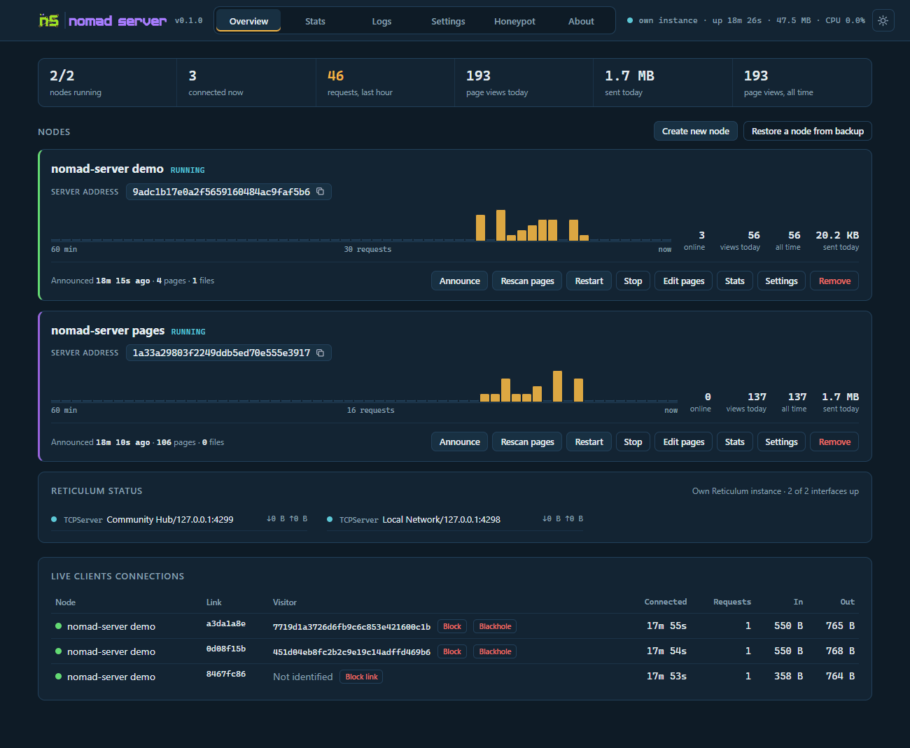
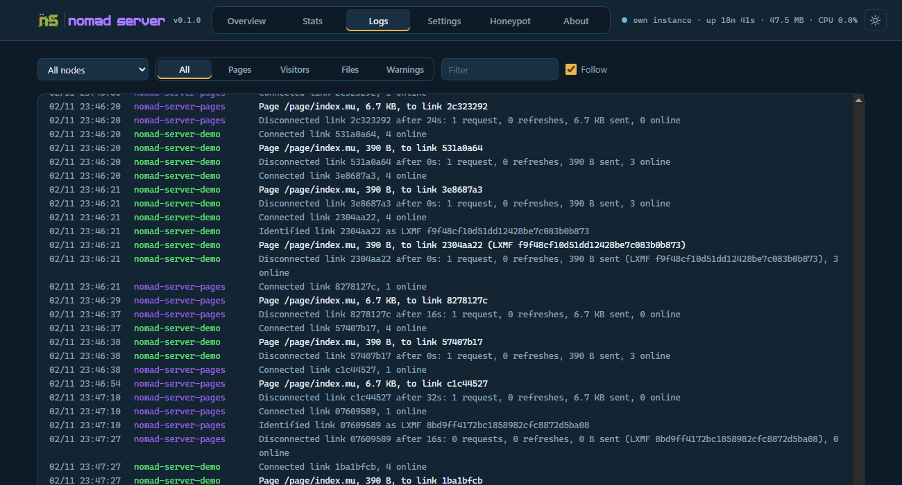
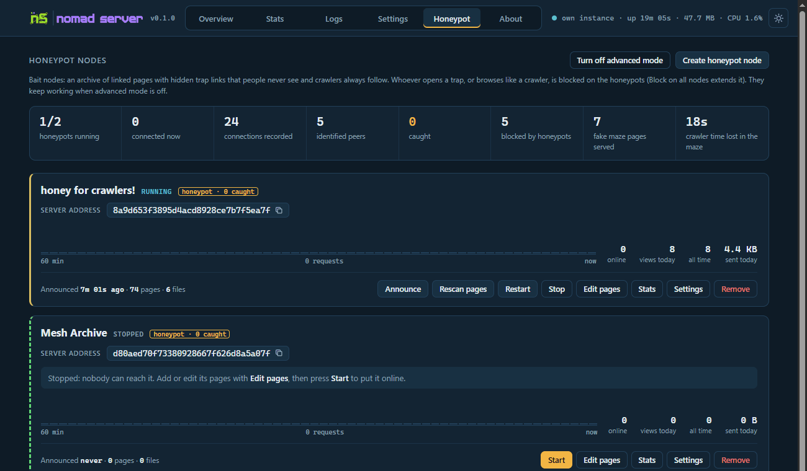

# nomad-server

<picture>
  <source media="(prefers-color-scheme: dark)" srcset="nserver/web/splash-dark.svg">
  
</picture>

Many [NomadNet](https://github.com/markqvist/NomadNet) nodes in one process, with a web UI to watch and manage them.

[](LICENSE) · [Italiano](README.it.md)



## Features

- **Many nodes, one process**: each node has its own folder, identity, pages, files and counters
- **Serves like NomadNet**: `.mu` pages, executable pages, `.allowed` lists, `/file/` downloads, inline images
- **Web UI**: overview, stats per hour and day, live log, settings, page editor, light and dark theme
- **Counters**: every request and every byte, `{{visits}}` placeholders in the pages, probable crawlers marked
- **Visitors**: who is connected, who identified, block a peer or a single link, blackhole an identity in Reticulum
- **Plugins**: dynamic pages in Python inside the server (guestbooks, forms, live data), also on Windows
- **Backup**: one zip per node, identity export and import, removed nodes kept in a trash
- **Honeypot nodes** (advanced): bait pages and hidden traps that catch crawlers
- Runs on Windows, Linux, macOS, Raspberry Pi and Docker; only needs `rns`

## Quick start

```
git clone https://github.com/fr33n0w/nomad-server
cd nomad-server
pip install rns
python nomad_server.py
```

Open http://127.0.0.1:8484, press **Create new node**, put your pages in `nodes/<node>/pages/` (`index.mu` is the home page), then press **Start**. New nodes start stopped, so nothing goes online before it is ready.

If `rnsd` is running, the nodes use it; otherwise nomad-server runs its own Reticulum instance with your `~/.reticulum` config.

## Ways to run it

| How | Command | Notes |
|---|---|---|
| Terminal | `python nomad_server.py` | log on screen, Ctrl+C stops it |
| App window | `python nomad_server.py --app` | the UI in its own window (Edge or Chrome); closing the window stops a server it started |
| Windows | `start.bat`, `start_hidden.vbs` | the second one runs with no window at all |
| Desktop icons | Settings > Shortcuts | desktop and app menu, Windows and Linux desktops |
| Debian, Ubuntu, Raspberry Pi | `bash install.sh` | installs `rns` if missing, optional password, systemd service at boot |
| pipx | `pipx install git+https://github.com/fr33n0w/nomad-server` | then `nomad-server`; data in `~/.nomad-server` |
| Docker | `mkdir nomad-data && docker compose up -d` | see [Docker](#docker) |

Only one server runs on a folder: the same identities can never be online twice. Started again with `--app`, it just opens the window.

## Command line

`python nomad_server.py [options]`, or `nomad-server [options]` when installed with pip or pipx.

**Starting the server**

| Option | |
|---|---|
| *(none)* | run, log on the terminal |
| `--app` | also open the web UI in an app window (Edge or Chrome); closing it stops a server it started. If the server already runs, only opens the window |
| `--service` | quiet: only warnings and errors on the terminal or journal, full log in `logs/server.log` |
| `--no-webui` | no web interface; the console commands below still work |
| `--verbose` | Reticulum debug log |
| `--base DIR` | folder with `server.cfg`, `nodes/` and `data/`. Default: next to the program, `~/.nomad-server` when installed with pip or pipx |

**Commands to the running server** (on the same folder, so with the same `--base`)

| Option | |
|---|---|
| `--status` | nodes, interfaces, visitors connected now |
| `--json` | with `--status`: the raw data |
| `--log [N]` | last N lines of the log (60 if N is left out) |
| `-f`, `--follow` | with `--log`: keep showing new lines (Ctrl+C to stop) |
| `--node ID` | with `--log`: only this node |
| `--stop` | stop it, also a hidden one (refused under systemd: use `systemctl stop nomad-server`) |
| `--block LXMF` | block a peer on every node |
| `--reason TEXT` | with `--block`: the reason shown to it |
| `--mode MODE` | with `--block`: `page` (default, a page with the reason), `silent`, `tarpit` or `maze` |
| `--unblock LXMF` | remove a peer from the blocklist |
| `--blocklist` | print the blocklist (identity hash, LXMF address, reason) |
| `--export-blocklist FILE` | save it to a text file |

**Working on the files** (no running server needed; restart it afterwards)

| Option | |
|---|---|
| `--new-node NAME` | create a node folder, with a new identity and a sample `index.mu` |
| `--set-password` | set the web UI password (empty = no password) |

**Other**: `--version`, `-h` / `--help`.

## Web UI

| | |
|---|---|
|  |  |
| **Stats**: requests and traffic per node, by hour or day, top pages and files, identified visitors | **Logs**: live, one color per node, filters for pages, visitors, files and warnings |

- **Overview**: nodes with a requests chart, Reticulum interfaces, the clients connected now
- **Settings**: server, web UI and node settings, identity, backup and restore, blocklist, removed nodes, shortcuts
- **Edit pages**: a file manager with an editor on each node; a saved page is served at once
- The address shown in the UI can be copied with one click; on a phone the layout follows

The web UI listens on 127.0.0.1:8484. To reach it from other devices set `host = 0.0.0.0` in `server.cfg` (or answer yes in `install.sh`) and set a password: whoever reaches the UI can manage the nodes. Over the network, editing pages and handling identities need the password.

## Nodes

```
nodes/my-node/
  node.cfg      settings (also from the web UI)
  identity      the node's private key: keep it private
  pages/        .mu pages, index.mu is the home page
  files/        downloads, served as /file/...
  data/         counters
  plugin.py     optional, dynamic pages
```

Pages are read at each request, so a changed page is served at once. New and deleted files are picked up every 5 minutes (`rescan_interval`), at once with **Rescan pages** or when saved in the editor.

| Setting | Default | |
|---|---|---|
| `name` | | name in NomadNet and in the announces |
| `enabled` | yes | start with the server |
| `announce_at_start` | yes | after a restart a node is reachable only once it announces again |
| `announce_interval` | 360 | minutes, 0 = only at start |
| `require_identify` | no | only visitors who identify see the pages |
| `requests_per_minute` | 120 | per visitor, 0 = no limit |
| `show_on_pages` | yes | replace `{{visits}}`, `{{visits_total}}`, `{{visits_today}}` |
| `footer.visits` | yes | a visits line at the bottom of pages without their own counter |
| `footer.watermark` | yes | a "served by nomad-server" line |

**Backup node** saves a zip with identity, settings, pages, files and counters; **Restore a node from backup** brings it back with the same address. **Import identity** gives a node the address of an existing one. Two nodes of a server can never share an identity.

## Counters

Every request is counted, reloads and identified visitors included. A page asked again by the same visitor within 10 seconds is a *refresh* (partials that reload themselves), shown apart. Links that open many pages fast are marked as probable crawlers, and still counted. Traffic is counted apart: content sent per page and file, link traffic in and out. Counters are saved every 30 seconds and when the server stops.

## Dynamic pages

- **Executable pages**, as in NomadNet: a `.mu` with a shebang (`#!/usr/bin/env python3`) and `chmod +x` runs at each request and what it prints is the page. Form fields and the visitor arrive as environment variables (`field_*`, `var_*`, `link_id`, `remote_identity`). On Windows pages with a Python shebang run too.
- **Plugins**: a `plugin.py` in the node folder, loaded once inside the server. No new process per request, also on Windows, and it gets the visitor's LXMF address and name.

```python
PATHS = ["/page/guestbook.mu"]

def start(node):      # optional: at node start (threads, generators)
    pass

def page(path, data, who=None, who_name="", link_id=None):
    # data: form fields (field_*, var_*); who: LXMF address if the visitor identified
    return ">Guestbook\n\nHello " + (who_name or "stranger") + "\n"

def stop():           # optional: at node stop
    pass
```

Plugins of all nodes share one Python process: give their helper modules distinct names.

## Moving an existing node here

A node made with NomadNet or `rns_server_page.py` moves without changing its address:

1. **Create new node**, then **Import identity** with the old node's `identity` file.
2. Copy its `pages/` and `files/`, or replace the two folders with links to the old ones if a program keeps writing them.
3. Copy its `data/visits.json`, if it has one: the old counts are added to the new counters, once.
4. Code that made pages inside the old server becomes a `plugin.py`; programs that rewrite pages in the background can be started and stopped by the plugin with the node.
5. Stop the old server, then press **Start**. Never run the same identity in two places at once.

## Visitors and blocking

Peers that identify are listed with their LXMF address and, when they announced one, their name. **Block** keeps a peer out of one node or all of them, with a reason, in four ways: a page with the reason, *silent* (dropped), *tarpit* (connected, no answers: time lost for a crawler, no bytes on the mesh) or *maze* (honeypots only). A link that did not identify can be blocked until it disconnects. **Export as text** writes the blocklist with identity hashes.

**Blackhole** adds a peer's identity to Reticulum's blackhole, by hand only: the local Reticulum instance drops its announces and the paths to its destinations, for every program using it. To share it, Reticulum transport nodes can publish their blackhole (`publish_blackhole`) and others can follow it (`blackhole_sources`).

## Honeypot nodes



Hidden behind advanced mode: click the logo in **About** five times. A honeypot is a node full of believable bait pages with trap links that people never see and crawlers follow. Whoever opens a trap, hops to a new link for every page, or reads too many pages too fast is caught: blocked on the honeypots if it identified, otherwise for the rest of its link. Caught peers can get a tarpit or a maze of small fake pages, rate limited so the mesh is never flooded. The Honeypot tab keeps the connection history, the known crawlers and whether they come back, even on new honeypots. Turning advanced mode off stops every honeypot, which stays stopped until started again, and hides them from all tabs; the blocklist stays as it is.

## Docker

```
mkdir nomad-data
NOMAD_PASSWORD=yourpassword docker compose up -d
```

The UI is on port 8484, everything else in `nomad-data/`: settings, nodes, identities, counters, logs and the Reticulum config (`nomad-data/reticulum/config`, created at the first start: add an interface, Docker networks have no peers for AutoInterface). The compose file runs as user 1000:1000 so the files stay yours, and comments show how to use the host's `rnsd` instead. Environment variables: `NOMAD_PASSWORD` (web UI password), `NOMAD_PORT` (UI port inside the container, default 8484), `NOMAD_RNS_CONFIG` (Reticulum config folder, default `/data/reticulum`). Console commands: `docker compose exec nomad-server python /app/nomad_server.py --base /data --status`. **Stop server** in the UI is restarted by Docker; use `docker compose stop`.

## Resources

On a Debian server with three busy nodes and a plugin, the process uses about 95 MB: about 36 MB are Python and Reticulum, the rest the nodes, counters and the plugin's data. An empty server uses about 47 MB.

## Credits

- [Reticulum](https://github.com/markqvist/Reticulum) and [NomadNet](https://github.com/markqvist/NomadNet) by Mark Qvist: nomad-server is built on Reticulum and serves pages the way NomadNet does. It uses the Reticulum License, as Reticulum does.
- [rns_server_page](https://github.com/SebastianObi/RNS-Tools/tree/main/rns_server_page) by Sebastian Obele: the page server this project grew out of: it began as counters, stats and a web UI added to it, then became a server of its own. It still reads its node folders and imports its `visits.json`. Its MIT notice is in [LICENSE](LICENSE).

## License

[Reticulum License](LICENSE), as Reticulum itself.
